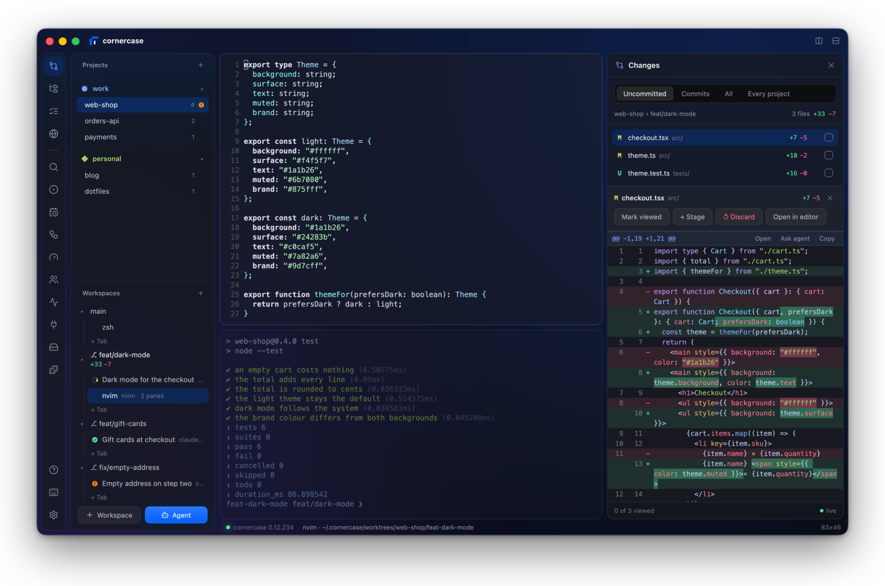

# cornercase-gpui

[](https://github.com/usecornercase/cornercase-gpui/actions/workflows/ci.yml?query=branch%3Amain)
[](#license)
[](#install)
[](https://discord.gg/aYqCa4xC4R)

A native macOS window for [cornercase](https://github.com/usecornercase/cornercase-terminal), the terminal multiplexer for running coding agents in parallel. It is drawn on the GPU with [GPUI](https://gpui.rs), the UI framework behind the Zed editor, and aims to do everything cornercase's own window does, with the look and feel of a Mac app.

It is only a window: cornercase's server keeps owning the shells, agents and worktrees, and this app drives it through the `cornercase` command line. Both windows show the same session, and closing either one stops nothing.



**[usecornercase.dev](https://usecornercase.dev)** · [cornercase](https://github.com/usecornercase/cornercase-terminal) · [Discord](https://discord.gg/aYqCa4xC4R)

## Features

- **Terminal.** Every pane sits on a floating card: drag the gap between cards to resize, select with the mouse, ⌘-click links and paths, drop files to paste them, and drag a pane by its handle onto another to move it.
- **Sidebar.** Groups, projects, workspaces and agents, with each agent's status, model and context, and each workspace's pull request with how its checks went: click it, or press ⌘P, for its failed checks, its stack and Ask agent. Drag to reorder, in any layout of cornercase's Settings → UI.
- **Previews.** Rest the pointer on a path a program printed and the file shows beside it: code at its lines, images, videos, sounds, PDFs. A click opens it in the Files panel.
- **Docked panels.** Changes (the workspace's diff, to stage, discard and review), Files (tree, viewer and search), TODO and a Browser.
- **A browser beside the agent.** A real Chrome on the workspace's dev servers, with device sizes and the console. Pick an element or take a screenshot and hand it to the agent.
- **The rest of cornercase.** Search, Issues, Queue, Flows, Usage, Accounts, Processes, Ports, Worktrees, Plugins, Settings and the guided tours, each one shortcut away. A flow, a team of agents, starts from its sheet, from an issue or from a project's `+`; from an issue, its task comes filled in with the issue's, ready to add to.
- **Other machines.** Connect the window to cornercase on another machine over your own `ssh`; it reconnects by itself when the link drops.
- **Notifications.** Agent notices as toasts and macOS notifications, with sounds and the bell.

## Install

There are no prebuilt releases yet, so build it from source. You need:

- macOS with the Xcode Command Line Tools (`xcode-select --install`)
- [rustup](https://rustup.rs), which installs the pinned Rust version on the first build
- [cornercase](https://usecornercase.dev/docs/installation/) 0.12.234 or newer on your `PATH`

```sh
git clone https://github.com/usecornercase/cornercase-gpui.git
cd cornercase-gpui
cargo install --locked --path .
```

The first build takes a couple of minutes, and puts `cornercase-gpui` in `~/.cargo/bin`.

## Usage

```sh
cornercase-gpui                   # opens on what cornercase's window shows
cornercase-gpui --tab 6           # or on a tab, workspace or project id (see `cornercase status`)
cornercase-gpui --remote devbox   # or on another machine's server, over ssh
```

It starts cornercase's server if none runs. `--remote` takes a host from `~/.ssh/config` or `user@host` and runs `cornercase` there through your own `ssh`, so your config, keys, agent and jump hosts apply. It never asks for a password: use a key or an agent. Add `--remote-command '~/bin/cornercase'` when `cornercase` is not on that machine's `PATH`. From a checkout, `cargo run --release --` takes the same flags.

These environment variables change its defaults:

| Variable | What it sets | Default |
| --- | --- | --- |
| `CORNERCASE_BIN` | The `cornercase` binary to drive | `cornercase` on the `PATH` |
| `CORNERCASE_GPUI_FONT_SIZE` | The terminal's font size (Menlo) | `13` |
| `CORNERCASE_GPUI_OPACITY` | The opacity of the terminal's background; `1` makes it opaque | `0.65` |
| `CORNERCASE_GPUI_CHROME` | The browser the Browser panel runs, headless | Chrome, Chromium, Edge or Brave |
| `CORNERCASE_GPUI_BROWSER_PROFILE` | Where that browser keeps its profile | `~/Library/Application Support/cornercase-gpui/browser` |

## Keys

Every key goes to the program in the active pane, except ⌘ shortcuts. ⌘/ lists them in the app.

| | Keys |
| --- | --- |
| **Tabs** | ⌘T new · ⇧⌘W close · ⌘1…9 go to one (⌘9 the last) · ⇧⌘[ ⇧⌘] previous, next |
| **Panes** | ⌘D split right · ⇧⌘D split down · ⌘[ ⌘] previous, next · ⌘W close what is on top, else the pane |
| **Projects** | ⌘O open a project · ⌘N new workspace · ⌘G start an agent · ⌘P the workspace's pull request · ⇧⌘P go to a file · ⇧⌘K connect to another server |
| **Panels** | ⇧⌘C Changes · ⇧⌘E Files · ⇧⌘L TODO · ⇧⌘B Browser |
| **Sheets** | ⌘F Search · ⌘I Issues · ⇧⌘S Queue · ⇧⌘G Flows · ⌘U Usage · ⇧⌘A Accounts · ⇧⌘M Processes · ⇧⌘O Ports · ⇧⌘T Worktrees · ⇧⌘X Plugins · ⌘, Settings |
| **Terminal** | ⌘C copy · ⌘V paste (an image as a file the agent can open) · ⌘+ ⌘- ⌘0 text size |
| **In the Browser** | ⌘L address · ⌘R reload · ⌘[ ⌘] back, forward · ⌘C ⌘X ⌘V on the page; every other key goes to the page |
| **Window** | ⌘H hide · ⌥⌘H hide the others · ⌘M minimise · ⌃⌘F full screen · ⌘Q quit |

The key that opens a panel or sheet also closes it. Esc closes the menu, dialog or sheet on top, or gives the keys back to the terminal. Text goes through macOS's input method, so dead keys and ⌥ characters (`@` on a Spanish keyboard) reach the program.

## How it works

The window never speaks cornercase's socket protocol. It follows `cornercase view` for the session and `cornercase surface` for what the panes show, types through `cornercase input --follow`, and does everything else with `cornercase` commands and their `--json`: the contract cornercase documents for programs that draw it ([#345](https://github.com/usecornercase/cornercase-terminal/issues/345)). On another machine, every command runs as `cornercase --remote DESTINATION …`.

When cornercase lacks something a feature needs, the gap is filed [upstream](https://github.com/usecornercase/cornercase-terminal/issues) instead of worked around, and the window names the issue the feature waits on. The two exceptions are by design: the Files panel reads the disk itself, and the Browser panel runs a headless Chrome and its ssh tunnels. The decisions behind each area, and why, are in [`design/`](design/), indexed by [DESIGN.md](DESIGN.md).

## Contributing

Bug reports, ideas and pull requests are welcome: [CONTRIBUTING.md](CONTRIBUTING.md) explains how to build, run and check a change. Ask questions on [Discord](https://discord.gg/aYqCa4xC4R), and report vulnerabilities privately, as [SECURITY.md](SECURITY.md) explains. The rules for every change, for people and coding agents alike, are in [AGENTS.md](AGENTS.md).

## License

Licensed under either of

- Apache License, Version 2.0 ([LICENSE-APACHE](LICENSE-APACHE))
- MIT license ([LICENSE-MIT](LICENSE-MIT))

at your option.

Unless you explicitly state otherwise, any contribution intentionally submitted for inclusion in the work by you, as defined in the Apache-2.0 license, shall be dual licensed as above, without any additional terms or conditions.

Some parts come from other projects and keep their licences:

- The text field (`src/ui/text_field.rs`) is adapted from gpui 0.2.2's `examples/input.rs`, copyright Zed Industries, under Apache-2.0 ([LICENSE-GPUI](LICENSE-GPUI)).
- The icons in `assets/icons/` are [Lucide](https://lucide.dev)'s, under ISC ([assets/icons/LICENSE](assets/icons/LICENSE)), with thinner strokes and two of them filled; the `status-*` icons are this project's own.
- The file-type icons in `assets/file-icons/` are glyphs of [Seti UI](https://github.com/jesseweed/seti-ui) and [Nerd Fonts](https://github.com/ryanoasis/nerd-fonts), under MIT ([assets/file-icons/LICENSE](assets/file-icons/LICENSE)).
